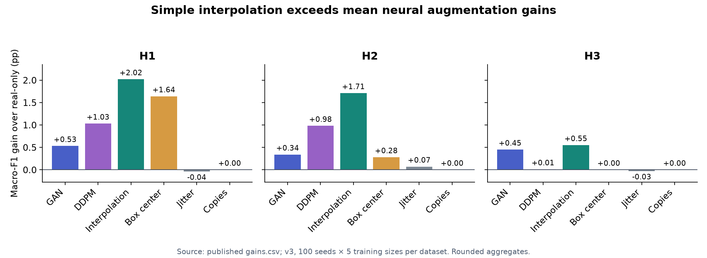
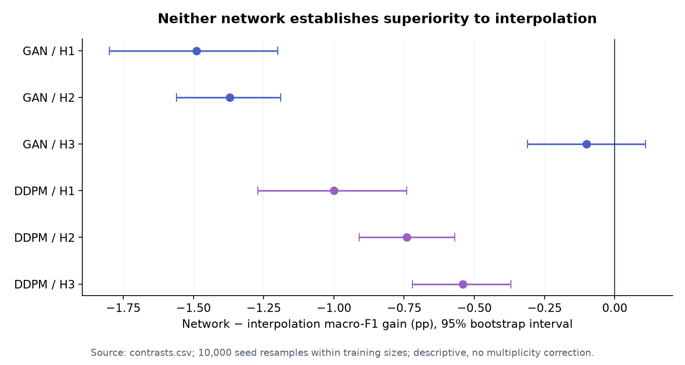

# Quantum phases: generative augmentation versus simple controls

**Can a GAN or a diffusion model help classify quantum phases when only 2–6
labeled examples per phase are available?** This project tests that question
for spin-1 chains, using a paired comparison against the same real-only
classifier and against inexpensive augmentation controls.

**Main finding:** neither trained generator met the predeclared criterion for
beating all three nontrivial controls on any of the three datasets. Simple
interpolation had the largest mean macro-F1 gain on all three. The negative
result is central: improvement over a real-only baseline alone does not
establish a benefit from learning a generative model.

Author: Murilo Costenaro Mascote. This is a curated research portfolio. Active
research, full manuscripts, original datasets and complete runs are maintained
separately. This repository has an independent publication history.

## What this contributes

- A paired few-shot evaluation: identical real training points and test points
  across GAN, DDPM, copies, box center, interpolation and Gaussian jitter.
- Train-only generation, fixed physical scaling, deterministic seed derivation
  and stable nearest-neighbor distances, with tests for numerical edge cases.
- Evidence that low-data augmentation gains can come from geometry or sample
  multiplicity, together with generator-collapse and data-quality diagnostics.

## Selected scientific results

Mean macro-F1 gain over the real-only 1-NN/L2 classifier, in **percentage points**:

| Method | H1 | H2 | H3 |
|---|---:|---:|---:|
| GAN v3 | +0.53 | +0.34 | +0.45 |
| DDPM v3 | +1.03 | +0.98 | +0.01 |
| Interpolation | +2.02 | +1.71 | +0.55 |
| Box center | +1.64 | +0.28 | 0.00 |
| Jitter | −0.04 | +0.07 | −0.03 |
| Copies | 0.00 | 0.00 | 0.00 |



Each arm has 1,500 units: 3 datasets × 5 training sizes × 100 seeds.
These are the v3 results after excluding seven rows with |C| > 1 at load time;
the original data files were preserved. H1/H2/H3 have 6,399/6,397/4,515 rows.
The network-versus-interpolation intervals are shown below; five exclude zero
on the negative side. GAN/H3 is inconclusive under this criterion.



The rounded aggregates are in [selected_results](selected_results/).
[Methods and limitations](docs/METHODS_AND_LIMITATIONS.md) describes the
criterion, tuning asymmetry, collapsed DDPM output, overlapping tests and
unresolved defects in the historical physical datasets. These findings concern
this finite-data classification setup and are not a general verdict on GANs
or diffusion models. The full grid is not reproduced by the small demo.

## Run the representative example

Verified platform: Linux/WSL, Python 3.12, CPU. Run from the repository root.
The pinned CPU PyTorch requirement targets Linux; native Windows/macOS
installation has not been validated.

```bash
git clone https://github.com/mcostenaro/quantum-phases-portfolio.git
cd quantum-phases-portfolio
python3.12 -m venv .venv
source .venv/bin/activate
python -m pip install -r requirements.txt
python -m pip install --no-deps -e .
python -m pip check
python -m pytest -q
python examples/demo.py --output outputs/demo-001
```

The example independently computes 36 data points by exact diagonalization
of a four-site spin-1 XXZ chain with single-ion anisotropy. It uses 9 spin
correlators, 3 real examples per parameter regime, 10 generated examples per
regime, one seed and 40 training steps for each network. All six arms run on
the same complementary test set. Labels denote sampled parameter regimes;
this tiny chain does not establish thermodynamic phases.

It prints real/augmented macro-F1 and writes metrics, synthetic samples,
generated data, parameters and a manifest with configurations, versions and
hashes. Copies must have exactly zero gain for 1-NN. Choose a new output
directory for each run; existing outputs are never overwritten. CPU execution
takes seconds to a few minutes depending on the machine.

This short training budget checks execution, **not model convergence** or the
scientific ranking above. The research used L=12, ED-21, 100 seeds and frozen
GAN/DDPM budgets of 3,000 and 3,000–10,000 steps respectively. See
[data and provenance](docs/DATA.md).

In the verified demonstration, real-only and all augmented arms score macro-F1
1.0 on these deliberately separated regimes; every gain is zero. This ceiling
is useful for checking execution and does not reproduce the research ranking.

To regenerate the two figures from the published aggregate tables:

```bash
python scripts/plot_selected_results.py
python scripts/verify_publication.py
```

## Repository contents

| Path | Content |
|---|---|
| `src/quantum_phases/` | Selected shared split, scale, controls and classifier code |
| `C_GAN/src/`, `C_difusion/src/` | Research GAN and DDPM implementations and adapters |
| `examples/` | Independent small ED dataset and paired demonstration |
| `tests/` | Controls, stable nearest neighbors, physics checks, split and generator tests |
| `selected_results/`, `docs/figures/` | Two aggregate tables and two reproducible figures |
| `PUBLICATION.json` | Exact selection, source revision and file hashes |

Some preserved shared modules retain historical dataset registrations; the
associated research CSVs and full experiment entry points are not distributed.
The supported public entry point is `examples/demo.py`.

## Reuse and updates

Project code and authored documentation: [MIT](LICENSE). The GAN retains its
YData architectural attribution and MIT notice; see
[third-party notices](THIRD_PARTY_NOTICES.md). No external research datasets
or third-party paper PDFs are redistributed. The literature and original data
sources are credited in [data documentation](docs/DATA.md).

See [updating the public selection](docs/UPDATING.md). Updates use selected
files from specific research revisions and ordinary commits onto this public
history; private Git history is never merged or pushed here.
